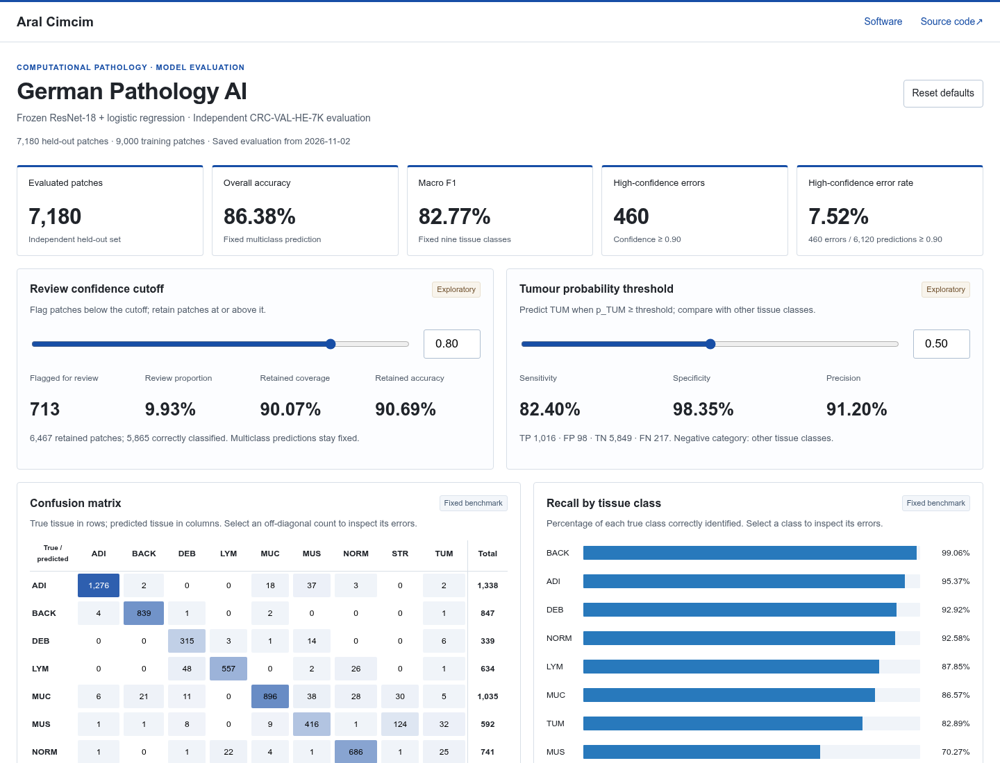

# German Pathology AI — Model Evaluation Dashboard

An interactive dashboard for a frozen tissue-classification baseline, evaluated on **7,180 held-out colorectal histology patches**. Explore the confusion matrix, class recall, confidence distribution, individual mistakes, review coverage and tumour probability thresholds.

**[Open the live dashboard](https://aralcimcim.github.io/german-pathology-ai/)** · **[Run the notebook in Colab](https://colab.research.google.com/github/aralcimcim/german-pathology-ai/blob/main/notebooks/01_model_evaluation.ipynb)** · [Power BI guide](powerbi/SETUP.md)



The website runs entirely in the browser using the saved predictions. It needs no Power BI account, server or model runtime. Changing a threshold recomputes the relevant metrics locally; it does not retrain the model.

## Actual evaluation

The supplied run completed on **2 November 2026**, using an NVIDIA L4 in Colab. It used 9,000 training patches (1,000 per class, seed 42), a frozen ImageNet ResNet-18 encoder, a training-only StandardScaler and logistic regression (`C=1`, `lbfgs`, `max_iter=2000`). The run metadata records classifier convergence.

| Fixed benchmark                                 |              Result |
| ----------------------------------------------- | ------------------: |
| Held-out patches                                |               7,180 |
| Correct multiclass predictions                  |               6,202 |
| Overall accuracy                                |              86.38% |
| Macro F1, all nine classes                      |              82.77% |
| Tumour sensitivity at p_TUM ≥ 0.50              |              82.40% |
| Tumour specificity at p_TUM ≥ 0.50              |              98.35% |
| Tumour precision at p_TUM ≥ 0.50                |              91.20% |
| Review proportion below confidence 0.80         | 9.93% (713 patches) |
| Retained coverage at confidence ≥ 0.80          |              90.07% |
| Retained accuracy at confidence ≥ 0.80          |              90.69% |
| Errors among predictions with confidence ≥ 0.90 | 460 / 6,120 (7.52%) |

The weakest class recalls are stroma (**46.32%**) and smooth muscle (**70.27%**). The confusion matrix includes 143 stroma → smooth-muscle errors and 124 in the opposite direction. High confidence does not guarantee correctness.

The dashboard verifies the predictions' SHA-256 against [run metadata](docs/data/run_metadata.json), checks the CSV schema and probability consistency, and compares **all 54 fixed metrics** with the saved Python [benchmarks](docs/data/model_metrics.csv) before displaying results. Tests also compare every one of the 81 confusion-matrix cells with the saved matrix.

## Interactions

- **Review confidence cutoff:** flags predictions with maximum class probability strictly below the cutoff. Retained coverage and accuracy use predictions at or above it.
- **Tumour probability threshold:** predicts TUM when `p_TUM >= threshold`. This separate binary decision can differ from multiclass argmax.
- **Matrix, recall and histogram selections:** filter the error table only. Fixed cohort metrics and the other charts remain based on all 7,180 patches.
- **Error table:** search by image ID or tissue code, restrict to high-confidence mistakes, sort confidence, paginate and download the selected rows as CSV.
- **Reset defaults:** restores review 0.80 / tumour 0.50 and clears inspection filters. Thresholds can also be shared in the URL, for example [`?review=0.35&tumour=0.66`](https://aralcimcim.github.io/german-pathology-ai/?review=0.35&tumour=0.66).

Counts display as integers; ratios display as percentages. Undefined ratios display an em dash. Zero-count matrix cells remain visible. The final confidence bin includes exactly 1.0.

## Run locally and test

Serve `docs/` with any static HTTP server. For example, with Python 3 installed:

```bash
python3 -m http.server 4179 --bind 127.0.0.1 --directory docs
```

Open `http://127.0.0.1:4179/`. Opening `index.html` directly with a `file://` URL cannot fetch the CSVs.

With Node.js 20 or later:

```bash
npm ci
npm test
npx playwright install chromium
npm run test:browser
```

`npm test` uses Node's built-in test runner and the actual exported data; no JavaScript dependencies are required for that command. Browser tests cover both controls, fixed results, inspection filters, CSV downloads, keyboard navigation, load failures and layouts at 375, 768 and 1440 pixels. To use an installed Chrome executable instead, set `PATHOLOGY_BROWSER_PATH=/path/to/google-chrome`.

## Reproduce or replace the results

Run [notebooks/01_model_evaluation.ipynb](notebooks/01_model_evaluation.ipynb) in Colab. [COLAB_CELLS.md](COLAB_CELLS.md) contains the same cells as copy/paste text. GPU is optional; runtime and disk quotas depend on Colab. The two original archives total approximately 12.5 GB; raw images are not included here.

The notebook freezes the protocol before held-out inference, samples only the normalized NCT-CRC-HE-100K training archive, fits the scaler/classifier on training embeddings only, then evaluates the complete independent CRC-VAL-HE-7K archive. It saves class ordering, versions, manifests, checksums and fixed benchmark metrics. No model or threshold selection uses the held-out cohort.

After extracting a new result export, import its approved artifacts:

```bash
python3 scripts/import_results.py /path/to/germ_path
npm test
npm run test:browser
```

The importer validates the predictions and source manifests against metadata checksums. It copies a fixed allowlist into `docs/data/` and `artifacts/`; it does not publish raw images, archives, embedding caches or unrelated files. Update the result summary and screenshot when replacing a run. The real-data regression tests intentionally assert the current snapshot; review and update those expectations for a different run rather than bypassing failures.

For Power BI, use [SETUP.md](powerbi/SETUP.md), the complete [DAX measures](powerbi/measures.dax), [report layout](powerbi/LAYOUT.md) and [export schemas](EXPORTS.md). The standalone website does not embed or depend on a Power BI semantic model.

## GitHub Pages

The site is published from **`main` → `/docs`** in this repository's **Settings → Pages**. The empty `docs/.nojekyll` file enables plain static hosting. Commit and push changes to update the public dashboard. All app and data URLs are relative, so the page works under the repository path. See [DEPLOYMENT.md](DEPLOYMENT.md) for details.

## Data source and limitations

Kather, Jakob Nikolas; Halama, Niels; Marx, Alexander (2018). _100,000 histological images of human colorectal cancer and healthy tissue_ (v0.1). Zenodo. **[DOI: 10.5281/zenodo.1214456](https://doi.org/10.5281/zenodo.1214456)**. Dataset licence: **[CC BY 4.0](https://creativecommons.org/licenses/by/4.0/)**. The published CSVs are derived predictions; processing comprises frozen ImageNet feature extraction and logistic-regression classification. [Attribution](docs/data/DATA_ATTRIBUTION.txt) and [source verification](sources/dataset_verification.json) are retained.

Training uses the normalized NCT-CRC-HE-100K archive; evaluation uses CRC-VAL-HE-7K from 50 other patients with no reported patient overlap. The source describes 224×224 H&E patches at 0.5 µm/pixel from Heidelberg and Mannheim, Germany. Reliable per-image patient/slide IDs were unavailable; filenames were not used to invent grouping metadata. The additional NONORM archive is excluded. Original images, encoder weights and embedding caches are not distributed in this repository.

These are **patch-level results, not patient diagnoses**. Patches within a patient are correlated. No patient-level uncertainty estimates, calibrated clinical risks or clinical validation are claimed. Other tissue classes include background and are not all benign. Threshold changes are exploratory descriptions of the final cohort and cannot establish an optimal clinical operating point. Future model tuning requires a separate development dataset or reliable grouped validation. Do not load joblib artifacts from untrusted sources.

## Repository layout

```text
notebooks/              Colab notebook and equivalent Python source
powerbi/                DAX, Power Query and browser report instructions
docs/                   Static HTML/CSS/JavaScript dashboard
  data/                 Actual predictions, metrics and provenance
artifacts/              Classifier, protocol, manifests and versions
scripts/import_results.py
sources/                Dataset verification and primary references
tests/                  Notebook helpers, metric checks and browser tests
```
